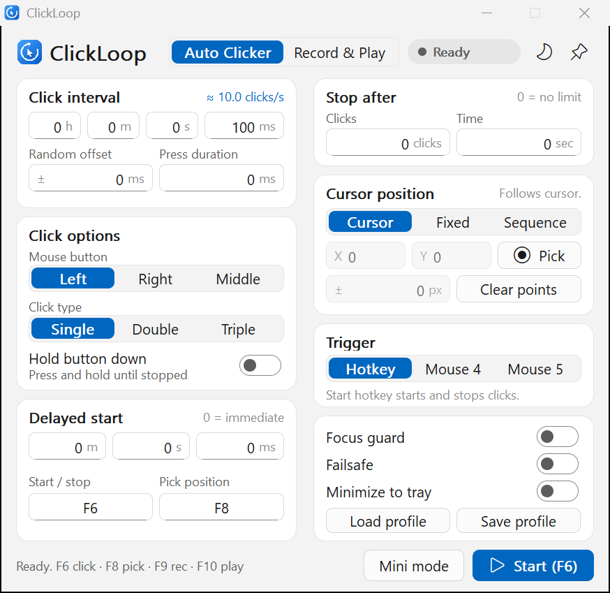
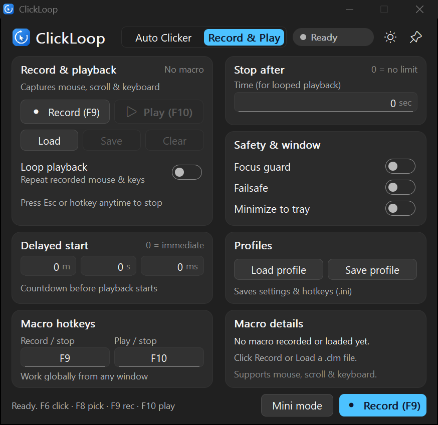
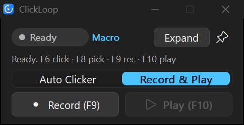
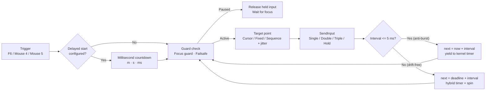
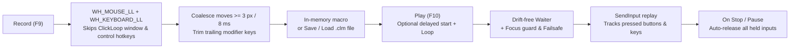
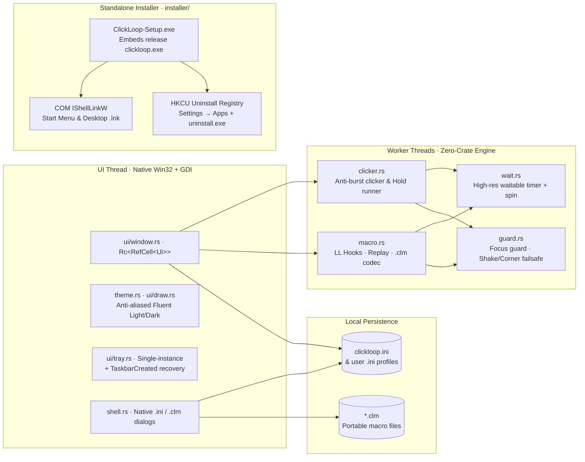

<p align="center">
  
</p>
<h1 align="center">ClickLoop</h1>
<p align="center"><strong>One native Rust binary. High-precision auto clicker. Mouse &amp; keyboard macro recorder.</strong></p>
<p align="center">
  A lightweight, zero-dependency Windows desktop utility combining a safe 1 ms auto clicker,
  a TinyTask-style Record &amp; Playback engine (<code>.clm</code>), a Fluent Light/Dark Win32 interface,
  and a standalone per-user installer &amp; uninstaller.
</p>
<p align="center">
  <a href="https://github.com/AndroLay/ClickLoop/releases/tag/v1.0.0"></a>
  
  
  
  
  
  <a href="LICENSE"></a>
</p>
<p align="center">
  <a href="#quick-start">Download &amp; install</a> ·
  <a href="#why-clickloop">Why ClickLoop</a> ·
  <a href="#inside-the-application">Screenshots</a> ·
  <a href="#features">Features</a> ·
  <a href="#how-it-works">How it works</a> ·
  <a href="#architecture">Architecture</a> ·
  <a href="docs/README.md">Documentation</a> ·
  <a href="CHANGELOG.md">Changelog</a>
</p>

> **Latest release: [v1.0.0](https://github.com/AndroLay/ClickLoop/releases/tag/v1.0.0).**
> Ready to use via **`ClickLoop-Setup.exe`** (installer + uninstaller, no admin required) or portable **`clickloop.exe`**.
> Both crates compile with zero external dependencies, pass `cargo clippy --all-targets -- -D warnings`, and pass all **20 unit tests** (15 app + 5 installer).

---

## Why ClickLoop?

Many Windows auto clickers are either bundled with heavy runtimes, split clicking and macro recording across separate apps, freeze the desktop when configured down to `1 ms`, or ship outdated UIs without reliable emergency stops. ClickLoop solves these problems in a single native executable built directly on Win32.

| Limitation in typical clickers | What ClickLoop provides |
| --- | --- |
| Heavy Electron / .NET runtimes or bundled adware | Pure Rust + Win32 with **zero external crates** — `476 KB` portable binary, instant startup |
| Separate tools needed for clicking vs. macro recording | Unified **Auto Clicker** and **Record & Playback** (mouse, scroll, keyboard + `.clm` files) in one balanced 2-tab window |
| `1 ms` click intervals lock up Windows or burst-flood inputs | Explicit `< 10 ms` warning + **anti-burst scheduling (`<= 5 ms`)** with kernel timer yield so UI and OS stay responsive |
| Rigid countdown presets or no delayed start | Free **`m / s / ms` delayed start** (`0–99m`, `0–99s`, `0–9999ms`) shared across clicking and macro playback |
| Hard to tell what is running when minimized | Compact **Mini mode** (`320 × 140`) showing active mode (`Clicker` / `Macro`), live status pill, tab switcher, and direct action controls |
| Runaway clicking when switching windows | Built-in **Focus guard**, **mouse-shake / top-left corner Failsafe**, and automatic release of held keys & buttons on stop |
| Messy ZIP extraction or UAC-heavy installers | Self-contained **`ClickLoop-Setup.exe`** (`881 KB`) with per-user install, Start Menu/Desktop shortcuts, and clean **Windows Settings → Apps** uninstaller |

---

## Inside the application

Actual captures from the Windows 11 release build (`v1.0.0`). Click any image to inspect at full resolution.

<table>
<tr>
<td width="50%" valign="top">
<h3>Auto Clicker (Fluent Light)</h3>
<p>Balanced 2-column layout with interval (<code>h/m/s</code> up to 99, <code>ms</code> up to 9999), random offset, press duration, click options, Hold mode, multi-point cursor targeting, delayed start, and safety toggles.</p>
<a href="docs/assets/screenshots/auto-clicker-light.png"></a>
</td>
<td width="50%" valign="top">
<h3>Record &amp; Playback (Fluent Dark)</h3>
<p>TinyTask-style macro capture for mouse moves, clicks, scroll wheel, and keyboard keys with <code>.clm</code> Save/Load, Loop playback, custom <code>F9</code>/<code>F10</code> global hotkeys, and microsecond replay precision.</p>
<a href="docs/assets/screenshots/record-play-dark.png"></a>
</td>
</tr>
<tr>
<td width="50%" valign="top">
<h3>Compact Mini Mode</h3>
<p>Shrinks to a floating <code>320 × 140</code> bar displaying the live status pill, active mode badge (<code>Clicker</code> or <code>Macro</code>), instant tab switch, pin-on-top toggle, and mode-aware action buttons.</p>
<a href="docs/assets/screenshots/mini-mode.png"></a>
</td>
<td width="50%" valign="top">
<h3>Native Installer &amp; Uninstaller</h3>
<p>Zero-dependency Win32 setup dialog installing into <code>%LOCALAPPDATA%\Programs\ClickLoop</code> with no UAC prompt, COM shortcuts, in-place updates, and full uninstall integration.</p>
<a href="docs/assets/screenshots/installer.png"></a>
</td>
</tr>
</table>

---

## Features

| Area | Capabilities | Details |
| --- | --- | --- |
| **Auto Clicker** | `h/m/s` (`0–99`), `ms` (`0–9999`), random interval jitter, press duration, Left/Right/Middle button, Single/Double/Triple click, **Hold** mode | `< 10 ms` warning + anti-burst `1 ms` safety |
| **Cursor Targeting** | Follow live cursor, lock to fixed `(X, Y)`, or cycle **2–5 picked points** with optional position jitter (`px`) | Global crosshair picker (`F8`, `Esc` to cancel) |
| **Triggers & Stop Limits** | Global toggle hotkey (`F6`), Mouse 4 / Mouse 5 hold-to-click, stop after `N` clicks or `S` seconds | Single-instance guard prevents hotkey clashes |
| **Record & Playback** | Captures cursor path (coalesced `>= 3 px` & `>= 8 ms`), mouse buttons, wheel, and keyboard down/up (scan codes + extended flags) | `.clm` save/load, Loop playback, custom `F9`/`F10` |
| **Delayed Start** | Free countdown in minutes (`0–99`), seconds (`0–99`), and milliseconds (`0–9999`) | Applies to both Auto Clicker and Macro Playback |
| **Safety Guards** | **Focus guard** (pauses when foreground window changes), **Failsafe** (rapid mouse shake or top-left `(0, 0)` corner) | Automatically releases any held buttons or keys |
| **UI & Workspace** | Fluent Light/Dark theme, DPI PerMonitorV2, balanced `580 × 540` 2-tab layout, `320 × 140` Mini mode, Always on top, System tray | Persists state in `clickloop.ini` + `.ini` profiles |
| **Installer & CLI** | Standalone `ClickLoop-Setup.exe` + `uninstall.exe`, silent flags (`--silent`, `--uninstall`), full CLI launch flags | Per-user install, registered in **Settings → Apps** |

---

## How it works

### High-precision Auto Clicker & anti-burst `1 ms` scheduling

At normal intervals (`> 5 ms`), ClickLoop advances deadlines drift-free using a hybrid waitable-timer + micro-spin waiter. At ultra-low intervals (`<= 5 ms`, down to `1 ms`), it schedules from completion time (`now + interval`) so OS scheduling hiccups never trigger runaway catch-up click bursts.



### Record & Playback pipeline (`.clm`)



### Runtime safety lifecycle

```mermaid
sequenceDiagram
    autonumber
    actor User
    participant UI as Main Window (Win32/GDI)
    participant Worker as Clicker / Macro Thread
    participant Guard as Focus Guard &amp; Failsafe
    participant OS as Windows Input Queue

    User->>UI: Press F6 (Click) or F10 (Play)
    UI->>Worker: Spawn / start worker with snapshot settings
    opt Delayed start &gt; 0 ms
        Worker->>Worker: Millisecond countdown (cancelable anytime)
    end
    loop Until stopped or limit reached
        Worker->>Guard: Check foreground HWND &amp; cursor velocity/corner
        alt Failsafe triggered
            Guard-->>Worker: Stop signal
            Worker->>OS: Release any held buttons/keys
        else Focus changed (Focus guard on)
            Guard-->>Worker: Pause
            Worker->>OS: Release held inputs until target window returns
        else Clear to run
            Worker->>OS: SendInput (click, move, wheel, or key)
        end
    end
    Worker-->>UI: Update status pill &amp; final counters
```

---

## Architecture



| Engineering principle | Implementation |
| --- | --- |
| **Zero external dependencies** | Both `clickloop` and `clickloop-installer` have empty `[dependencies]` — all Win32, GDI, COM, registry, and `.ico` rendering live in clean internal modules |
| **Re-entrancy safe Win32 state** | UI state uses `Rc<RefCell<Ui>>` (`UiCell`) with explicit `window_alive(hwnd)` guards across modal dialogs and DPI changes |
| **Per-monitor crisp rendering** | `PerMonitorV2` DPI awareness, `AdjustWindowRectExForDpi`, custom anti-aliased rounded corners without GDI+ overhead, proper GDI handle cleanup on `WM_DPICHANGED` |
| **Stuck-key prevention** | Macro playback tracks every synthetic mouse button and virtual key pressed and releases them automatically on stop, pause, or failsafe |
| **Non-elevated install safety** | Installs into `%LOCALAPPDATA%\Programs\ClickLoop` (`asInvoker`) so no UAC elevation is needed and `clickloop.ini` stays writable |

Deep dive: [Architecture Guide](docs/ARCHITECTURE.md) · [User Guide](docs/USER_GUIDE.md) · [Installer &amp; Uninstaller Reference](docs/INSTALLER.md)

---

## Quick start

### Option 1: Windows Installer (Recommended)

1. Download **`ClickLoop-Setup.exe`** from [Releases v1.0.0](https://github.com/AndroLay/ClickLoop/releases/tag/v1.0.0).
2. Run `ClickLoop-Setup.exe` and click **Install** (or **Update** if already installed).
3. ClickLoop is installed to `%LOCALAPPDATA%\Programs\ClickLoop`, with Start Menu/Desktop shortcuts and an uninstaller registered in **Settings → Apps**.

Silent install & uninstall flags:

```powershell
# Silent install without Desktop shortcut
.\ClickLoop-Setup.exe --silent --no-desktop

# Silent uninstall (keeps clickloop.ini unless --remove-config is passed)
& "$env:LOCALAPPDATA\Programs\ClickLoop\uninstall.exe" --silent --remove-config
```

See [docs/INSTALLER.md](docs/INSTALLER.md) for all installer and uninstaller workflows.

### Option 2: Portable executable

Download **`clickloop.exe`** from [Releases v1.0.0](https://github.com/AndroLay/ClickLoop/releases/tag/v1.0.0), place it in any writable folder, and run it directly. Settings save to `clickloop.ini` next to the executable.

### Option 3: Build from source

**Requirements**
- Windows 10 or Windows 11 (x64)
- Rust toolchain with the `x86_64-pc-windows-gnu` target
- `windres` (from MinGW-w64, e.g. MSYS2 UCRT64) on `PATH`

```powershell
git clone https://github.com/AndroLay/ClickLoop.git
cd ClickLoop

# Build portable release binary -> target\release\clickloop.exe
cargo build --release

# Build both release binary and standalone installer -> dist\ClickLoop-Setup.exe
.\scripts\build-installer.ps1
```

---

## Default hotkeys &amp; CLI reference

### Hotkeys

| Action | Default | Scope | Customizable |
| --- | --- | --- | --- |
| Start / Stop Auto Clicker | `F6` | Global | Yes (in UI) |
| Pick Cursor Position | `F8` | Global | Yes (in UI) |
| Record / Stop Macro | `F9` | Global | Yes (in UI) |
| Play / Stop Macro | `F10` | Global | Yes (in UI) |
| Cancel Picker / Hotkey Capture / Stop Macro | `Esc` | Active overlay / playback | — |

### Command-line options

| Flag | Description |
| --- | --- |
| `--interval MS` | Interval between clicks in milliseconds |
| `--limit N` | Stop after `N` clicks (`0` = no limit) |
| `--time S` | Stop after `S` seconds (`0` = no limit) |
| `--jitter MS` | Random `+/- MS` added to each interval |
| `--button NAME` | `left`, `right`, or `middle` |
| `--profile FILE` | Load an `.ini` profile before applying other CLI overrides |
| `--start` | Start Auto Clicker immediately after the window opens |
| `--help` | Display the usage dialog |

```powershell
clickloop.exe --profile farming.ini --interval 50 --limit 200 --start
```

---

## Project structure

```text
ClickLoop/
├── build.rs                      # Embeds generated .ico, PerMonitorV2/ComCtl32 manifest, VERSIONINFO
├── build/icon.rs                 # Pure-Rust anti-aliased multi-size icon renderer
├── src/
│   ├── main.rs                   # Entry point, CLI handling, single-instance mutex
│   ├── clicker.rs                # Auto clicker & Hold worker with anti-burst scheduling
│   ├── macro.rs                  # WH_MOUSE_LL + WH_KEYBOARD_LL recorder, playback, .clm I/O
│   ├── config.rs                 # Settings parser/writer (clickloop.ini) & CLI overrides
│   ├── guard.rs                  # Focus guard & mouse-shake / corner failsafe
│   ├── keys.rs                   # Virtual-key validation & human-readable key labels
│   ├── picker.rs                 # Global cursor coordinate picker overlay
│   ├── shell.rs                  # Native Windows Open/Save dialogs (.ini and .clm)
│   ├── theme.rs                  # Fluent Light/Dark palettes & GDI anti-aliased primitives
│   ├── wait.rs                   # High-resolution waitable timer + micro-spin waiter
│   ├── win32.rs                  # Zero-crate Win32 FFI bindings
│   └── ui/                       # Window state, 2-tab layout, drawing, events, mini mode, tray
├── installer/                    # Standalone zero-crate Win32 installer & uninstaller (ClickLoop-Setup.exe)
├── scripts/
│   └── build-installer.ps1       # End-to-end release + installer packaging script
├── docs/                         # User guide, architecture, installer manual, screenshots
├── CHANGELOG.md                  # Release history
└── LICENSE                       # MIT License
```

---

## Verification &amp; quality gates

Run all checks locally:

```powershell
cargo fmt --check
cargo clippy --all-targets -- -D warnings
cargo test

cargo fmt --manifest-path installer/Cargo.toml --check
cargo clippy --manifest-path installer/Cargo.toml --all-targets -- -D warnings
cargo test --manifest-path installer/Cargo.toml
```

Latest verified results (`v1.0.0`):
- **Main application (`clickloop`)**: `cargo fmt --check` clean, `cargo clippy --all-targets -- -D warnings` clean, **15/15 unit tests passed**, release binary `476 KB`.
- **Installer (`clickloop-installer`)**: `cargo fmt --check` clean, `cargo clippy --all-targets -- -D warnings` clean, **5/5 unit tests passed** (CLI/exe-name auto-uninstall detection, registry command quoting, size rounding, embedded PE verification, live COM `.lnk` creation), release binary `881 KB`.

---

## Notes &amp; limitations

- **Single instance:** Launching ClickLoop while already running brings the existing window to the foreground (including when minimized to the system tray) and recovers its tray icon if Windows Explorer restarts.
- **Windows UIPI:** ClickLoop runs as a standard user (`asInvoker`). Windows security blocks non-elevated applications from sending synthetic input into elevated (Administrator) windows unless ClickLoop is also started as Administrator.
- **Responsible use:** Automated mouse and keyboard input may violate the terms of service of certain online games or platforms. Use ClickLoop responsibly and only where permitted.

---

## Documentation

| Document | Contents |
| --- | --- |
| [docs/README.md](docs/README.md) | Documentation hub and reading guide |
| [docs/USER_GUIDE.md](docs/USER_GUIDE.md) | Complete guide to Auto Clicker, Record &amp; Playback, `.clm` format, profiles, CLI, and troubleshooting |
| [docs/ARCHITECTURE.md](docs/ARCHITECTURE.md) | Internal design, threading model, timing precision, hook coalescing, and rendering pipeline |
| [docs/INSTALLER.md](docs/INSTALLER.md) | Interactive and silent installation, update, uninstallation, and packaging guide |
| [CHANGELOG.md](CHANGELOG.md) | Version history and release highlights |
| [LICENSE](LICENSE) | MIT License |
