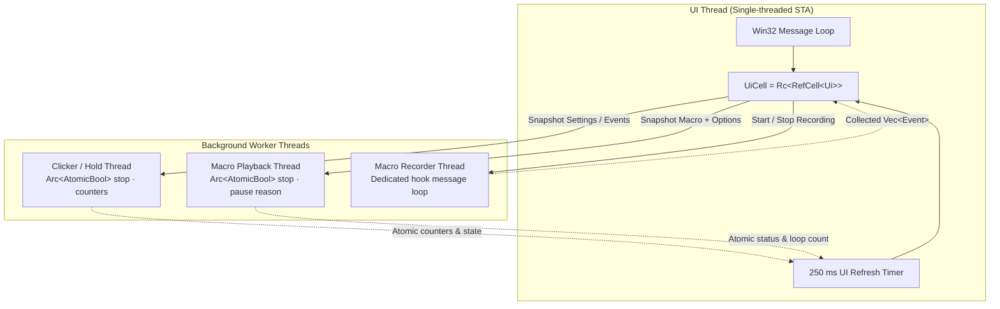

# ClickLoop Architecture

ClickLoop is designed around three core constraints: **zero external crates**, **predictable real-time input safety**, and **crisp native Windows ergonomics** in a sub-500 KB footprint.

---

## 1. Crate &amp; Module Map

The repository contains two standalone zero-dependency Rust crates:

1. **Main application (`Cargo.toml` → `clickloop.exe`)**
   - `build.rs` + `build/icon.rs`: Generates multi-resolution anti-aliased `.ico` assets (plus a 256×256 PNG preview), embeds a `PerMonitorV2` + `ComCtl32 v6` + `asInvoker` manifest, and embeds `VERSIONINFO` via `windres`.
   - `src/main.rs`: CLI argument parsing, `--help` dialog, and `CreateMutexW("Local\\ClickLoop.SingleInstance")` single-instance enforcement.
   - `src/win32.rs`: Typed Win32 FFI bindings (`user32`, `gdi32`, `kernel32`, `shell32`, `comdlg32`, `dwmapi`, `winmm`).
   - `src/theme.rs`: Fluent Light/Dark palettes (`Pal`), DPI-scaled fonts/brushes, and stack-allocated anti-aliased rounded-rectangle rendering (no GDI+ dependency, no large persistent bitmaps).
   - `src/ui.rs` + `src/ui/*`: Window lifecycle, balanced 2-tab layout (`layout.rs`), control construction (`create.rs`), owner-draw Fluent controls (`draw.rs`), message dispatch (`events.rs`), actions (`actions.rs`), state binding (`settings.rs`), and system tray with `TaskbarCreated` recovery (`tray.rs`).
   - `src/clicker.rs`: Auto clicker and Hold-mode worker thread.
   - `src/macro.rs`: Low-level mouse/keyboard hook recorder, `.clm` codec, and drift-free playback worker.
   - `src/wait.rs`: High-resolution interruptible `Waiter` combining Windows waitable timers (`CREATE_WAITABLE_TIMER_HIGH_RESOLUTION`) with a short final spin.
   - `src/guard.rs`: Foreground window Focus Guard and mouse-shake / top-left corner Failsafe detector.
   - `src/picker.rs`: Full-screen coordinate picker overlay using `WH_MOUSE_LL`.
   - `src/config.rs`, `src/keys.rs`, `src/shell.rs`: Settings/profile `.ini` I/O, hotkey validation, and native `GetOpenFileNameW`/`GetSaveFileNameW` dialogs (`OFN_NOCHANGEDIR`).

2. **Standalone Installer (`installer/Cargo.toml` → `ClickLoop-Setup.exe`)**
   - `installer/build.rs`: Reuses `../build/icon.rs` and embeds `ClickLoop Setup` metadata.
   - `installer/src/win32.rs`: Minimal Win32 GUI, Registry (`advapi32`), Shell (`shell32`), and raw COM vtable bindings (`IShellLinkW` + `IPersistFile`) for zero-subprocess `.lnk` creation.
   - `installer/src/install.rs`: Embedded `clickloop.exe` payload (`include_bytes!`), graceful app shutdown (`WM_CLOSE`), retry writes, shortcut generation, HKCU Uninstall registration, and deferred self-cleanup for `uninstall.exe`.
   - `installer/src/main.rs`: PerMonitorV2 DPI-scaled Win32 Setup / Uninstall UI and CLI dispatcher.

---

## 2. Threading &amp; State Safety Model

### Re-entrancy Protection (`UiCell`)
Win32 message handlers (`wnd_proc`) are inherently re-entrant: calling `SetWindowTextW`, `DestroyWindow`, `MessageBoxW`, or native file dialogs synchronously dispatches nested messages back into `wnd_proc`.
- ClickLoop stores UI state as `Rc<RefCell<Ui>>` (`UiCell`) in `GWLP_USERDATA`.
- Every message handler clones the `Rc` before touching state, drops any `RefMut` borrow **before** invoking modal dialogs or re-entrant Win32 calls, and verifies `window_alive(hwnd)` after returning from modal flows.
- On `WM_DPICHANGED`, child windows are destroyed **before** dropping the old `Theme` GDI font/brush handles so no control ever references a freed handle.

---

## 3. Timing Precision &amp; `1 ms` Anti-Burst Scheduling

- **`Waiter` (`src/wait.rs`):** Requests `CREATE_WAITABLE_TIMER_HIGH_RESOLUTION` (Windows 10 1803+) with fallback to standard waitable timers, sleeping in the kernel until ~1–2 ms before the deadline and performing a brief bounded yield/spin for sub-millisecond accuracy while polling the `stop` atomic flag.
- **Anti-burst rule (`src/clicker.rs`):**
  - When `interval > 5 ms`: next deadline advances from the previous target (`deadline + interval`) to preserve long-term cadence without drift.
  - When `interval <= 5 ms` (such as `1 ms` clicking): `schedule_next()` advances from **completion time** (`now + interval`). If Windows pauses the thread briefly, ClickLoop never emits a sudden catch-up flood of `SendInput` events that could freeze input processing.

---

## 4. Macro Recording &amp; Replay Integrity

- **Isolated hook thread:** `WH_MOUSE_LL` and `WH_KEYBOARD_LL` run on a dedicated thread with its own message pump so hook latency stays tiny and never trips Windows' `LowLevelHooksTimeout`.
- **Event filtering &amp; coalescing:**
  - Ignores events with `LLMHF_INJECTED` / `LLKHF_INJECTED` flags (prevents feedback loops).
  - Ignores mouse events occurring inside ClickLoop's own window rectangle.
  - Skips configured control hotkeys (`rec_key`, `play_key`, `Esc`) and trims trailing modifier key-downs captured right as the user hits the stop hotkey.
  - Coalesces mouse move samples (`>= 3 px` Euclidean delta and `>= 8 ms` interval) to keep `.clm` files compact and smooth.
- **Held-input tracking:** Playback maintains the set of currently pressed synthetic mouse buttons and virtual keys (`pressed_keys`). On stop, completion, failsafe trigger, or Focus Guard pause, every held button/key receives a matching key-up/button-up `SendInput` event so the user is never left with a stuck `Shift`, `Ctrl`, or mouse button.

---

## 5. Single-Instance &amp; System Tray Recovery

- A named mutex (`Local\ClickLoop.SingleInstance`) ensures only one ClickLoop instance registers global hotkeys.
- A second launch locates `"ClickLoopWindow"` via `FindWindowW`, posts custom message `WM_RESTORE_APP`, and calls `SetForegroundWindow` — restoring the app seamlessly even when hidden in the system tray.
- ClickLoop registers `"TaskbarCreated"` at startup and re-adds its tray icon automatically if Windows Explorer restarts while minimized to tray.
